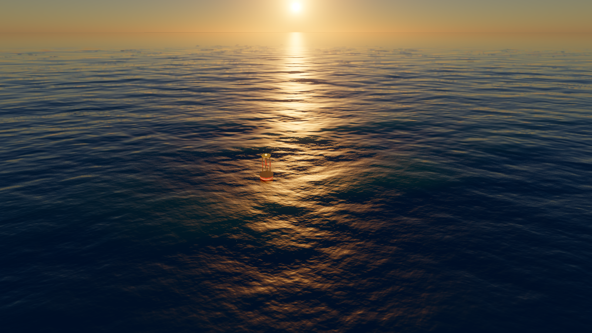

# Ocean

A custom real-time sunset ocean in Rust + wgpu: physically based FFT waves, whitecaps driven
by the waves' own folding, hardware ray-traced reflections, spray, and a floating buoy, at
60 fps in a 1280×720 window.



## What's in it

- **Waves**: four 256² FFT cascades (1 km swell down to 12 cm ripples) evolved on the GPU from
  a JONSWAP spectrum (fetch-limited, capped at full development) plus a swell component.
- **Whitecaps**: foam is injected where the combined horizontal displacement folds the surface
  (Jacobian below a threshold), accumulates and decays; spray that lands adds to it.
- **Sky**: Hillaire 2020 atmosphere (transmittance, multiple scattering, sky-view LUTs).
- **Water shading**: Fresnel, GGX sun glitter whose roughness carries the slope variance of
  unresolved wave scales, deep-water scattering, crest glow, aerial perspective, refraction of
  the buoy's hull.
- **Reflections**: hardware ray queries against a 512 m patch of the displaced waves (refitted
  every frame) and the buoy, so crests reflect and hide each other; screen-space fallback.
- **Particles**: spray bursts from breaking crests (from ~8 m/s wind), faint mist.
- **Buoy**: a five-point spring-damper float riding a GPU wave-height query.

GPU frame ≈ 5–6 ms (p95 5.85 ms) at 1600×900 on an RTX 2000 Ada laptop GPU.

## Requirements

- Windows; a GPU with Vulkan ray-query support (developed on an NVIDIA RTX 2000 Ada laptop GPU).
  Without ray query it falls back to screen-space reflections. On hybrid-graphics laptops the
  exe asks for the discrete GPU.

## Build and run

```
cargo run --release
```

The exe looks for `shaders/` next to itself or in the working directory (for hot reload) and
otherwise uses the copies compiled in.

## Controls

| Key | |
|---|---|
| A / D | steer the raft |
| W / S | paddle forward / back (push off a beach) |
| Space | sail up / down |
| C | camera: chase → deck → high → free fly |
| WASD, Q / E, right-drag, Shift | free fly: move, down / up, look, fast |
| F1 | settings panel (raft status, wind, fetch, swell, foam, spray, sun, reflections, render scale, vsync) |
| F2 | fps readout (detailed GPU timings via the settings panel) |
| F5 | reload shaders from disk (errors shown, last good shaders keep running) |
| Esc | quit |

## Command line

- `--set key=value` — set any setting, e.g. `--set wind_speed=15 --set sun_elevation_deg=1`
- `--bench N [--bench-out file.json]` — render N frames uncapped after a warm-up and write GPU
  and CPU frame-time statistics as JSON
- `--panel` — open the settings panel at start
- `--freeze-time S` — pin the waves at time S (for side-by-side comparisons)

## Tests

`cargo test` runs the wave physics, spectrum, foam, buoy, shader validation and other unit
tests, plus headless GPU tests (GPU FFT vs CPU reference, wave query vs CPU surface, ray query).
